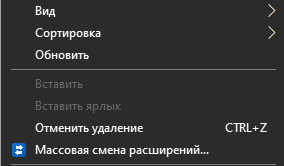
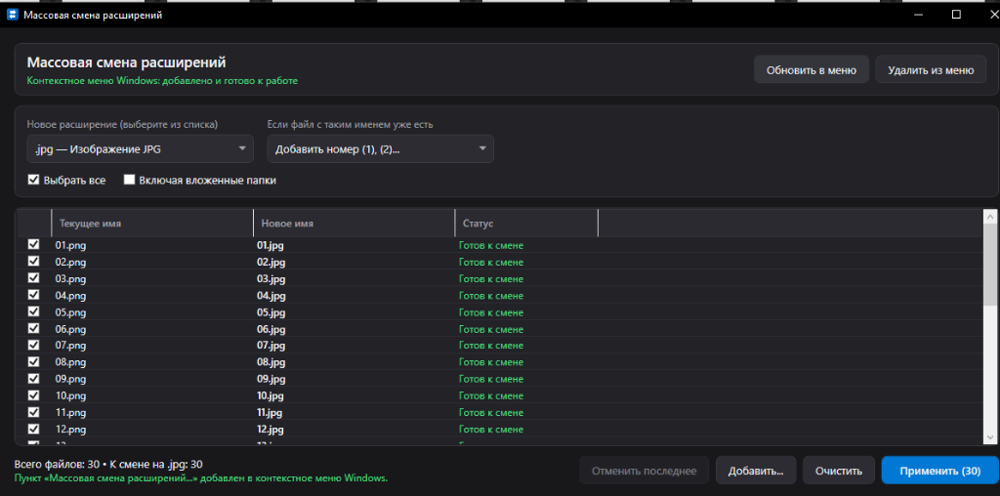
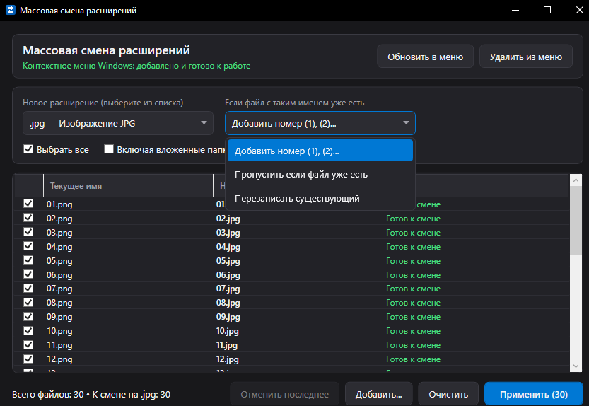
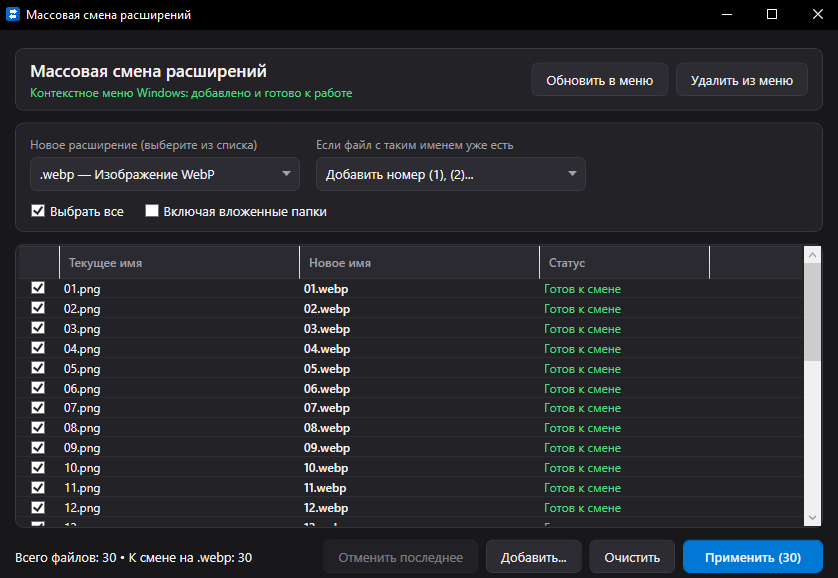

# Массовая смена расширений — BulkExtensionChanger (v1.1.0)

[](https://github.com/sensitivecode/BulkExtensionChanger/releases/latest)
[](https://github.com/sensitivecode/BulkExtensionChanger/actions/workflows/release.yml)
[](LICENSE)


Локальная кроссплатформенная утилита для массовой смены расширений файлов прямо из контекстного меню файлового менеджера, работающая полностью **без интернета**.

**Язык:** [Русский](#русская-версия-ru) | [English](#english-version-en)  
**Быстрый переход:** [Скриншоты](#скриншоты) · [Важно: переименование ≠ конвертация](#важно-переименование--конвертация) · [Установка](#установка) · [FAQ](#частые-вопросы-faq)

> [!TIP]
> **Быстрая установка:** скачайте готовый установщик для вашей ОС со страницы [**Releases**](https://github.com/sensitivecode/BulkExtensionChanger/releases/latest) (качать исходный код через *Code → Download ZIP* не нужно).

---

## Скриншоты

| Пункт в контекстном меню Windows | Массовый выбор в одном окне (30 файлов) |
| :---: | :---: |
|  |  |
| **Безопасное разрешение конфликтов имён** | **Мгновенный предпросмотр для 43+ расширений** |
|  |  |

---

## Важно: переименование ≠ конвертация

> [!WARNING]
> **Переименование расширения не конвертирует содержимое файла!**  
> Программа изменяет **только расширение в имени файла** (например, `01.png` → `01.webp` или `notes.txt` → `notes.md`) и **не перекодирует** байты изображений/документов. Если переименовать `.png` в `.jpg` или `.webp`, фактический формат внутри файла останется прежним, и некоторые программы просмотра могут отказаться его открывать.  
> Для восстановления исходных расширений после запуска сразу доступна кнопка **«Отменить последнее»**.

---

## Русская версия (RU)

> [!NOTE]
> **Примечание по macOS и Linux:**  
> Версии и установщики для **Linux** и **macOS** не тестировались на реальных устройствах, так как у автора нет техники с этими операционными системами. Если вы столкнётесь с ошибками или проблемами интеграции — пожалуйста, создайте [**Issue**](https://github.com/sensitivecode/BulkExtensionChanger/issues).

### Основные возможности
- **Все выделенные файлы в одном окне**: при выделении 20, 30 и более файлов в Проводнике Windows они автоматически объединяются в единый список через локальный `NamedPipe` IPC (не открывается десяток отдельных окон).
- **Интеграция без прав администратора**: добавление и удаление пункта `Массовая смена расширений...` в `HKCU\Software\Classes` (файлы, папки и пустая область папки) в один клик прямо из интерфейса или установщика.
- **43 готовых расширения + ручной ввод**:
  - **Изображения:** `png`, `jpg`, `jpeg`, `webp`, `gif`, `bmp`, `ico`, `svg`, `tiff`, `tif`, `avif`, `heic`
  - **Текст и данные:** `txt`, `md`, `json`, `xml`, `yaml`, `yml`, `csv`, `log`, `ini`, `cfg`, `conf`, `env`
  - **Код и скрипты:** `html`, `htm`, `css`, `js`, `ts`, `jsx`, `tsx`, `py`, `cs`, `cpp`, `c`, `h`, `java`, `go`, `rs`, `sh`, `bat`, `ps1`, `sql`
  - **Своё расширение:** пункт *«Своё расширение (ввести вручную)...»* для любого произвольного формата.
- **Защита от потерь и коллизий**: режимы `Добавить номер (1), (2)...`, `Пропустить если файл уже есть`, `Перезаписать существующий`, защита от перезаписи внутри одного пакета, пропуск скрытых dot-файлов (`.env`, `.gitignore`) и откат кнопкой **«Отменить последнее»**.
- **Работа с папками**: переключение галочки *«Включая вложенные папки»* для рекурсивной обработки.

### Установка

#### Windows (`BulkExtensionChanger-Setup.exe`) — *проверено на Windows 10/11 (x64)*
- **Требования:** [.NET 8 Desktop Runtime (x64)](https://dotnet.microsoft.com/download/dotnet/8.0).
- Запустите `BulkExtensionChanger-Setup.exe` со страницы [**Releases**](https://github.com/sensitivecode/BulkExtensionChanger/releases/latest).
- Мастер установит приложение в `%LocalAppData%\Programs\BulkExtensionChanger`, добавит пункт контекстного меню, ярлыки и зарегистрирует деинсталлятор в разделе Windows *«Приложения и возможности»*.

#### macOS (`BulkExtensionChanger-macOS.dmg` / `.zip`) — *не тестировалось*
- **Требования:** macOS 12+, Python 3 с поддержкой `tkinter`.
- Откройте `.dmg` или распакуйте `.zip` и запустите `Install-macOS.command` — скрипт установит `BulkExtensionChanger.app` в `~/Applications` и быструю службу Finder (`~/Library/Services/Массовая смена расширений.workflow`). Для удаления используйте `Uninstall-macOS.command`.

#### Linux (`bulk-extension-changer_1.1.0_all.deb` / `.tar.gz`) — *не тестировалось*
- **Требования:** `python3`, `python3-tk`.
- Для Debian/Ubuntu: `sudo apt install ./bulk-extension-changer_*_all.deb` (зависимость `python3-tk` подтянется автоматически).
- Для остальных дистрибутивов: распакуйте `BulkExtensionChanger-Linux.tar.gz` и запустите `./install.sh` (добавит ярлык и пункты меню для **GNOME Nautilus**, **KDE Dolphin** и **Cinnamon Nemo**; удаление — `./uninstall.sh`).

### Сборка из исходников (Windows)
```powershell
powershell -ExecutionPolicy Bypass -File .\build-all.ps1 -Version "1.1.0"
```

### Частые вопросы (FAQ)
- **Нужен ли интернет при работе?** Нет, программа полностью автономна и не отправляет никаких данных.
- **Почему Windows SmartScreen показывает предупреждение?** Бинарный файл не подписан платным коммерческим сертификатом. Весь исходный код открыт и собирается прозрачно через GitHub Actions с проверкой `checksums-sha256.txt` в релизах.
- **Почему для Windows и macOS/Linux разные исходники?** Windows-версия написана на нативном C#/WPF для быстрой интеграции с Проводником (`IDropTarget` + `NamedPipe`), а кроссплатформенная версия для macOS и Linux — на стандартном Python + `tkinter` без сторонних зависимостей.

---

## English Version (EN)

> [!WARNING]
> **Renaming ≠ Conversion:**  
> This utility changes **only the filename extension** (e.g., `01.png` → `01.webp` or `notes.txt` → `notes.md`). It does **not** transcode or convert image/file contents. If you encounter any bugs, use the **Undo** button immediately.

> [!NOTE]
> **Notice for macOS & Linux:**  
> The **Linux** and **macOS** builds and installers have **not been tested on real hardware**, as the author does not own devices running those operating systems. If you encounter bugs or integration issues, please open an [**Issue**](https://github.com/sensitivecode/BulkExtensionChanger/issues).

### Features
- **Single-window multi-select**: selecting 20, 30, or more files in Windows Explorer opens them together in **one preview window** via local `NamedPipe` IPC.
- **Zero-admin Windows integration**: installs/removes the Explorer context menu entry (`HKCU\Software\Classes`) for files, folders, and folder background.
- **43 preset extensions + custom input**: common image (`png`, `jpg`, `jpeg`, `webp`, `gif`, `bmp`, `ico`, `svg`, `tiff`, `tif`, `avif`, `heic`), text/config (`txt`, `md`, `json`, `xml`, `yaml`, `yml`, `csv`, `log`, `ini`, `cfg`, `conf`, `env`), and code/script extensions (`html`, `htm`, `css`, `js`, `ts`, `jsx`, `tsx`, `py`, `cs`, `cpp`, `c`, `h`, `java`, `go`, `rs`, `sh`, `bat`, `ps1`, `sql`), plus manual custom extension entry.
- **Safe collision handling & Undo**: auto-numbering `(1)`, `(2)...`, skip, overwrite (with same-batch overwrite protection and dotfile skipping), recursive subfolder toggle, and one-click **Undo**.

### Installation
1. **Windows (`BulkExtensionChanger-Setup.exe`)** — tested on Windows 10/11 (x64); requires [.NET 8 Desktop Runtime (x64)](https://dotnet.microsoft.com/download/dotnet/8.0).
2. **macOS (`BulkExtensionChanger-macOS.dmg` / `.zip`)** *(untested)* — requires macOS 12+ and Python 3 with `tkinter`; run `Install-macOS.command`.
3. **Linux (`bulk-extension-changer_1.1.0_all.deb` / `.tar.gz`)** *(untested)* — requires `python3` and `python3-tk`; install the `.deb` package or run `./install.sh` (Nautilus, Dolphin, Nemo).

### Build from Source (Windows)
```powershell
powershell -ExecutionPolicy Bypass -File .\build-all.ps1 -Version "1.1.0"
```

### Disclaimer & License
Provided **AS IS**, without warranty of any kind, under the [**GNU General Public License v3.0 (GPL-3.0)**](LICENSE).
